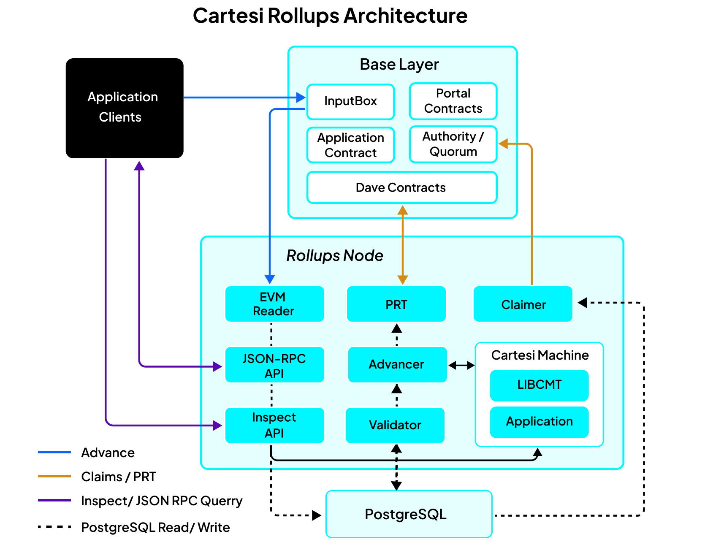

# Cartesi Rollups Node

[](https://github.com/cartesi/rollups-node/releases)
[](https://github.com/cartesi/rollups-node/actions/workflows/build.yml)
[](LICENSE)

The Cartesi Rollups Node is the middleware that connects the Rollups smart contracts, the application back-end running inside the Cartesi Machine, and the front-end.

> [!NOTE]
> This README covers the 2.0 line, which is currently published as alpha pre-releases on [GitHub Releases](https://github.com/cartesi/rollups-node/releases). The 1.x line is developed on the `release/1.x` branches; the most recent is [`release/1.5.x`](https://github.com/cartesi/rollups-node/tree/release/1.5.x).

## Overview

The node connects four parts of a Cartesi Rollups deployment:

- **Base layer (for example, Ethereum):** provides application inputs, settlement, and consensus contracts.
- **Cartesi Machine:** executes an application's back end deterministically.
- **PostgreSQL:** stores applications, inputs, outputs, reports, epochs, claims, proofs, and operational state. All node services coordinate through it.
- **Application clients:** submit inputs through the base layer, query indexed state through JSON-RPC, and send read-only requests through the Inspect API.



Advance requests are submitted to the on-chain `InputBox`, read by the EVM reader, executed by the application machine in the advancer, and persisted with their outputs and reports. The validator creates epoch claims and updates outputs with their proofs. The claimer submits claims for Authority or Quorum applications, while the PRT service takes part in Dave tournaments.

Inspect requests follow a separate path. They are sent directly to the node, executed on a fork of the application's machine, and answered synchronously without advancing the application's state.

## Getting started

Building an application? [Cartesi CLI](https://github.com/cartesi/cli) runs a local node for you with `cartesi run`. The steps below are for installing and operating a node yourself.

### Installation

#### Runtime requirements

- Linux on amd64 or arm64 for the provided container and Debian packages
- The Cartesi Machine emulator version required by the node release (the Debian package declares the exact range)
- PostgreSQL; version 18 is used by development and CI
- An Ethereum JSON-RPC HTTP endpoint
- Funded signers for the claimer and PRT services when claim submission is enabled

#### Debian package

Each release publishes amd64 and arm64 packages on [GitHub Releases](https://github.com/cartesi/rollups-node/releases). Download the node package, read the emulator version it requires, then install both:

```sh
VERSION="<node-version>"            # for example, 2.0.0-alpha.14
ARCH="$(dpkg --print-architecture)"

curl -fLO "https://github.com/cartesi/rollups-node/releases/download/v${VERSION}/cartesi-rollups-node-v${VERSION}_${ARCH}.deb"
dpkg-deb -f "cartesi-rollups-node-v${VERSION}_${ARCH}.deb" Depends

EMULATOR_VERSION="<emulator-version-in-that-range>"
curl -fLO "https://github.com/cartesi/machine-emulator/releases/download/v${EMULATOR_VERSION}/machine-emulator_${ARCH}.deb"

sudo apt install "./machine-emulator_${ARCH}.deb"
sudo apt install "./cartesi-rollups-node-v${VERSION}_${ARCH}.deb"
```

#### From source

Source builds require the Go version declared in [`go.mod`](go.mod), GNU Make, a C toolchain, `pkg-config`, OpenSSL development files, and the Cartesi Machine emulator headers and libraries.

```sh
git clone https://github.com/cartesi/rollups-node.git
cd rollups-node
make build
sudo make install
```

`make install` copies the binaries to `/usr/bin` on Linux and `/opt/cartesi/bin` on macOS; set `PREFIX` to change this.

### Running a node

#### Standalone mode

`cartesi-rollups-node` starts the EVM reader, advancer, validator, claimer, PRT service, JSON-RPC API, and Inspect API in one process. This is the simplest deployment model and is the one used by [`compose.yaml`](compose.yaml).

The following example shows the minimum shape of a live-network configuration. Supply deployment-specific values through the referenced shell variables before running it.

```sh
export CARTESI_BLOCKCHAIN_HTTP_ENDPOINT="${ETHEREUM_RPC_URL:?set ETHEREUM_RPC_URL}"
export CARTESI_BLOCKCHAIN_ID="${CHAIN_ID:?set CHAIN_ID}"
export CARTESI_DATABASE_CONNECTION="${DATABASE_URL:?set DATABASE_URL}"
export CARTESI_AUTH_KIND=mnemonic
export CARTESI_AUTH_MNEMONIC_FILE=/run/secrets/cartesi_mnemonic
export CARTESI_PRT_AUTH_KIND=mnemonic
export CARTESI_PRT_AUTH_MNEMONIC_FILE=/run/secrets/cartesi_mnemonic

cartesi-rollups-cli db init
```

The claimer and PRT signers can share one mnemonic file because they derive different accounts from it: index `0` for the claimer and index `6` for PRT by default (`CARTESI_AUTH_MNEMONIC_ACCOUNT_INDEX`, `CARTESI_PRT_AUTH_MNEMONIC_ACCOUNT_INDEX`). Use distinct addresses for the two signers, and fund both. See [Transaction delivery](docs/transaction-delivery.md) for signer setup, limits, recovery, and removal.

> [!IMPORTANT]
> `CARTESI_FEATURE_CLAIM_SUBMISSION_ENABLED` and `CARTESI_BLOCKCHAIN_DEFAULT_BLOCK` are saved in the database when the node first starts. Starting later with a different value fails; changing them on an existing database is not supported.

The node only processes an application after its contract exists on the configured chain and the application is registered in the node database. Choose one of the following workflows.

To deploy a new application contract and register it in one command, configure the deployed InputBox and self-hosted application factory addresses, then run:

```sh
export CARTESI_CONTRACTS_INPUT_BOX_ADDRESS="${INPUT_BOX_ADDRESS:?set INPUT_BOX_ADDRESS}"
export CARTESI_CONTRACTS_SELF_HOSTED_APPLICATION_FACTORY_ADDRESS="${SELF_HOSTED_APPLICATION_FACTORY_ADDRESS:?set SELF_HOSTED_APPLICATION_FACTORY_ADDRESS}"

cartesi-rollups-cli deploy application \
  my-app \
  "${APPLICATION_SNAPSHOT:?set APPLICATION_SNAPSHOT}"
```

By default, this deploys the application with a new Authority consensus contract, registers it in the database, and enables it. Alternatively, if a compatible application contract is already deployed on the configured chain, register its address directly:

```sh
cartesi-rollups-cli app register \
  --name my-app \
  --address "${APPLICATION_ADDRESS:?set APPLICATION_ADDRESS}" \
  --template-path "${APPLICATION_SNAPSHOT:?set APPLICATION_SNAPSHOT}"
```

After completing either workflow, start the node:

```sh
cartesi-rollups-node
```

Other deployment modes, such as using an existing consensus contract or deploying a PRT application, are covered by `cartesi-rollups-cli deploy application --help`. To run without signing or submitting transactions, set `CARTESI_FEATURE_CLAIM_SUBMISSION_ENABLED=false` before the first start; no signer is then required.

#### Multi-process mode

Each service is also available as an individual `cartesi-rollups-*` binary. Use this mode when services need separate resource limits, failure domains, or scaling policies. All processes share the same PostgreSQL database. [`compose.individual-services.yaml`](compose.individual-services.yaml) shows a split deployment of the EVM reader, advancer, validator, claimer, PRT service, and JSON-RPC API.

## Configuration

The node is configured through `CARTESI_*` environment variables. Service binaries also accept command-line flags for common settings; run `<binary> --help` to list them.

| Variable                                   | Purpose                                                              | Default                                   |
| ------------------------------------------ | -------------------------------------------------------------------- | ----------------------------------------- |
| `CARTESI_BLOCKCHAIN_HTTP_ENDPOINT`         | Ethereum JSON-RPC endpoint                                           | Required                                  |
| `CARTESI_BLOCKCHAIN_ID`                    | Expected chain ID                                                    | Required                                  |
| `CARTESI_DATABASE_CONNECTION`              | PostgreSQL connection URL                                            | PostgreSQL driver defaults                |
| `CARTESI_AUTH_KIND`                        | Claimer signer: `private_key`, `private_key_file`, `mnemonic`, `mnemonic_file`, or `aws` | `mnemonic`            |
| `CARTESI_PRT_AUTH_KIND`                    | PRT signer, same kinds as the claimer                                | `mnemonic`                                |
| `CARTESI_FEATURE_CLAIM_SUBMISSION_ENABLED` | Submit claims and PRT transactions; saved at first start             | `true`                                    |
| `CARTESI_BLOCKCHAIN_DEFAULT_BLOCK`         | `latest`, `safe`, or `finalized` block for chain reads; saved at first start | `finalized`                       |
| `CARTESI_SNAPSHOTS_DIR`                    | Machine snapshot directory                                           | `/var/lib/cartesi-rollups-node/snapshots` |
| `CARTESI_LOG_LEVEL`                        | Global `debug`, `info`, `warn`, or `error` level                     | `info`                                    |
| `CARTESI_JSONRPC_MAX_INFLIGHT`             | Concurrent JSON-RPC request limit                                    | `64`                                      |
| `CARTESI_INSPECT_MAX_INFLIGHT`             | Concurrent Inspect request limit                                     | `64`                                      |

The blockchain endpoint, blockchain HTTP authorization header, database connection, and the mnemonic and private-key settings of both signers accept a `*_FILE` variant that reads the value from a file, for example `CARTESI_AUTH_MNEMONIC_FILE=/path/to/secret`.

`make env` prints the local development settings. Generate the complete configuration reference with:

```sh
make generate-config-docs
```

The reference is written to `docs/config.md`.

## HTTP APIs and ports

The standalone process exposes three HTTP surfaces:

| Default port | Surface  | Paths               | Recommended exposure   |
| -----------: | -------- | ------------------- | ---------------------- |
|        10000 | Health   | `/livez`, `/readyz` | Internal only          |
|        10011 | JSON-RPC | `/rpc`              | Behind a reverse proxy |
|        10012 | Inspect  | `/inspect/{dapp}`   | Behind a reverse proxy |

In multi-process mode, each service exposes its own health port:

| Service      | Health port | Additional API port |
| ------------ | ----------: | ------------------: |
| EVM reader   |       10001 |                   — |
| Advancer     |       10002 |     10012 (Inspect) |
| Validator    |       10003 |                   — |
| Claimer      |       10004 |                   — |
| JSON-RPC API |       10005 |               10011 |
| PRT          |       10006 |                   — |

All HTTP services bind to all interfaces by default and are unauthenticated. Restrict them with private networking or a firewall, and place JSON-RPC and Inspect behind a reverse proxy that provides TLS, authentication, and rate limiting. See [HTTP deployment posture](docs/http-posture.md) for request limits, timeouts, and proxy guidance.

API references:

- [JSON-RPC API overview and methods](https://docs.cartesi.io/cartesi-rollups/2.0/api-reference/jsonrpc/overview/)
- [Inspect OpenAPI specification](api/openapi/inspect.yaml)

## Operations

### Health and backups

`/livez` reports whether the process is alive and `/readyz` whether it is ready to serve work. Back up the PostgreSQL database and the `CARTESI_SNAPSHOTS_DIR` directory together.

### Logging

Set the global level with `CARTESI_LOG_LEVEL`. Override individual services with:

- `CARTESI_LOG_LEVEL_ADVANCER`
- `CARTESI_LOG_LEVEL_CLAIMER`
- `CARTESI_LOG_LEVEL_EVM_READER`
- `CARTESI_LOG_LEVEL_JSONRPC_API`
- `CARTESI_LOG_LEVEL_PRT`
- `CARTESI_LOG_LEVEL_VALIDATOR`

### Upgrading

Review the target release on [GitHub Releases](https://github.com/cartesi/rollups-node/releases), back up PostgreSQL and machine snapshots, and install the emulator version required by the target package. Then upgrade and validate the database schema:

```sh
cartesi-rollups-cli db init --upgrade
cartesi-rollups-cli db check-version
```

## CLI and tools

### `cartesi-rollups-cli`

| Command                                               | Purpose                                                                                                         |
| ----------------------------------------------------- | --------------------------------------------------------------------------------------------------------------- |
| `app`                                                 | List, register, and remove applications; change their status; manage execution parameters                      |
| `db`                                                  | Initialize, upgrade, and validate the database schema                                                           |
| `deploy`                                              | Deploy applications and Authority or Quorum consensus contracts                                                 |
| `deposit erc20`                                       | Deposit ERC-20 tokens into an application                                                                       |
| `send`                                                | Send an input to an application                                                                                 |
| `inspect`                                             | Call the Inspect API                                                                                            |
| `execute`, `validate`                                 | Execute proven outputs and validate notices on-chain                                                            |
| `read`                                                | Read epochs, inputs, outputs, reports, withdrawals, tournaments, commitments, matches, match advances, and standing changes |
| `contract`                                            | Experimental: read on-chain contract state directly                                                            |
| `foreclose`, `prove-drive-root`, `withdraw`, `refund` | Foreclose an application, withdraw account funds, and refund unfinalized deposits                               |

Run `cartesi-rollups-cli --help`, or generate the complete command reference with `make generate-cli-docs`. For the foreclosure and withdrawal workflow, see the [Emergency Withdrawal Recovery Guide](https://docs.cartesi.io/cartesi-rollups/2.0/development/emergency-withdrawal/recovery-guide/).

### `cartesi-rollups-machine-tool`

- `replay` replays accepted inputs from the node database into a machine template.
- `prove accounts-drive` generates the accounts-drive root and account withdrawal proofs from a stored machine.

The machine tool is installed with the node binaries. Run `cartesi-rollups-machine-tool --help` for the required flags.

## Repository layout

```text
api/        OpenAPI specification for the Inspect API
cmd/        entry points for the node, service binaries, CLI, and machine tool
internal/   node services, configuration, machine manager, models, and repositories
pkg/        reusable emulator, machine, contract, JSON-RPC, and Inspect packages
test/       integration tests, devnet, test applications, and test tooling
docs/       operator references
```

## Development

This section is for working on the node itself: building and testing from a clone of this repository. Each task can run directly on your machine (the host) or inside Docker containers.

Host builds require the dependencies listed under [From source](#from-source).

```sh
make build
make docs
```

Host unit tests use the local Anvil devnet, a test database, and the development environment:

```sh
make devnet
eval "$(make env)"
make start
make test
make stop
```

For containerized tests, build the devnet and tester images first:

```sh
make devnet
make tester-image
make unit-test-with-compose
make integration-test-with-compose
```

The first containerized run downloads Cartesi Machine test images. Run `make help` to list all targets; see the [Makefile](Makefile) for integration-test options such as `NODE_TOPOLOGY`.

### Local stack with Docker Compose

`make image` builds a local node image tagged `cartesi/rollups-node:devel`; it is not a published release image. The repository's [`compose.yaml`](compose.yaml) uses it, together with the devnet image built by `make devnet`, to start an Anvil development chain, PostgreSQL 18, a database migration job, and the standalone node. Both images are built from source, so the first run takes a while. The stack publishes host ports 8545 (Anvil), 5432 (PostgreSQL), 10000, 10011, and 10012; free them first, for example by stopping a local PostgreSQL server. Then run:

```sh
make image
make devnet
docker compose up -d
until curl --fail --silent http://localhost:10000/readyz; do sleep 1; done
```

Inspect the stack or follow its logs with:

```sh
docker compose ps
docker compose logs -f node
```

This starts the infrastructure but does not build, deploy, or register an application. Use [Cartesi CLI](https://github.com/cartesi/cli) to build an application machine, then deploy and register it as described in [Running a node](#running-a-node).

Remove the local containers and their volumes when finished:

```sh
docker compose down -v
```

## Contributing

Read [CONTRIBUTING.md](CONTRIBUTING.md) and the [CHANGELOG](CHANGELOG.md) before opening a pull request, and follow the [Code of Conduct](CODE_OF_CONDUCT.md) in all project interactions.

The Cartesi Rollups Node is actively developed by [Cartesi](https://cartesi.io/)'s Node Reference Unit, with significant contributions from many open-source developers. For a complete list of authors, see the [AUTHORS](AUTHORS) file.

## Security

Do not open a public issue, pull request, or discussion for a security problem. Report it privately by email to [rollups@cartesi.foundation](mailto:rollups@cartesi.foundation) with the affected component and version, the impact and who is affected, and steps to reproduce. Email is not encrypted, so say so in your first message if the report contains sensitive material. The full policy and the published security reviews are on the [Audit reports](https://docs.cartesi.io/get-started/audit-reports/) page.

Keep mnemonic and private-key material out of environment dumps and command histories: prefer the `*_FILE` settings or AWS KMS, and restrict secret-file permissions. Use one submitting process per signer, and do not send transactions from an active node's signer with the CLI or another wallet.

## Related projects and support

- [Cartesi CLI](https://github.com/cartesi/cli): builds and runs Cartesi applications
- [Rollups contracts](https://github.com/cartesi/rollups-contracts): smart contracts for Cartesi Rollups
- [Cartesi Machine emulator](https://github.com/cartesi/machine-emulator): the off-chain implementation of the Cartesi Machine
- [Dave](https://github.com/cartesi/dave): Cartesi's permissionless fraud-proof system
- [Rollups Explorer](https://github.com/cartesi/rollups-explorer): web application for exploring Cartesi Rollups applications
- [Application templates](https://github.com/cartesi/application-templates): templates for Cartesi CLI

Join the [Cartesi Discord](https://discord.gg/cartesi) to discuss the node with users and maintainers. Use [GitHub Issues](https://github.com/cartesi/rollups-node/issues) for reproducible bugs and feature requests, including the node version, deployment mode, sanitized logs, and non-secret configuration.

## License

The project's own code, including all contributions to it, is available under the [Apache License, Version 2.0](LICENSE).
This code is also offered under the [GNU Lesser General Public License, Version 3](licenses/LGPL-3.0.txt), making it dual-licensed: you may use it independently in other applications under either license, at your option.

The distributed node includes LGPL-licensed dependencies.
In particular, go-ethereum is statically linked into every binary, so the node as a whole is subject to LGPL-3.0 when distributed with it.
Only go-ethereum's library packages are used, that is, everything outside `cmd/`.

Third-party components and code covered by separate LICENSE / COPYING files remain subject to their respective licenses.
See [THIRD_PARTY_LICENSES.md](THIRD_PARTY_LICENSES.md) for details.

The Cartesi Machine emulator is a dynamic library in its own package. A recipient can replace it without a new build of the node.
The complete source of this project is in this repository under Apache 2.0. To build the node against a different go-ethereum, add a `replace` directive for `github.com/ethereum/go-ethereum` to `go.mod` and run `make build`.
The full text of the LGPL-3.0 and the GPL-3.0 is in [licenses/](licenses).
